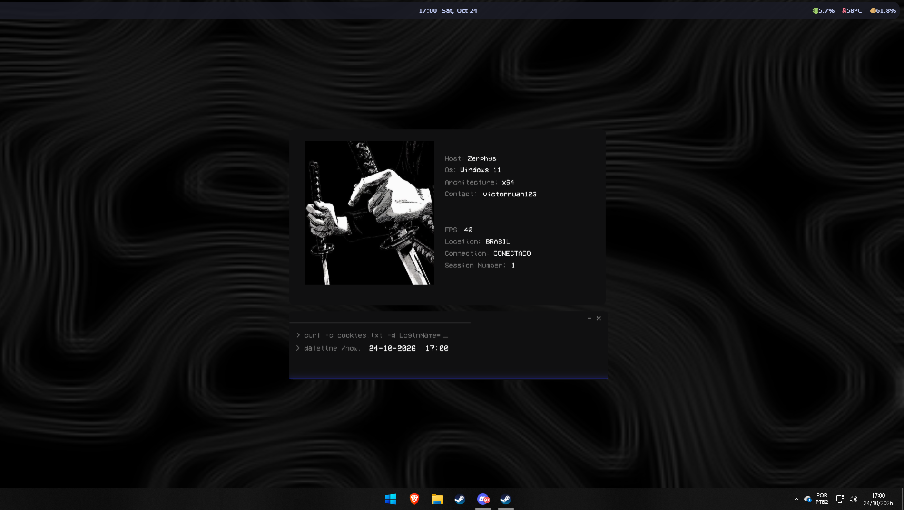
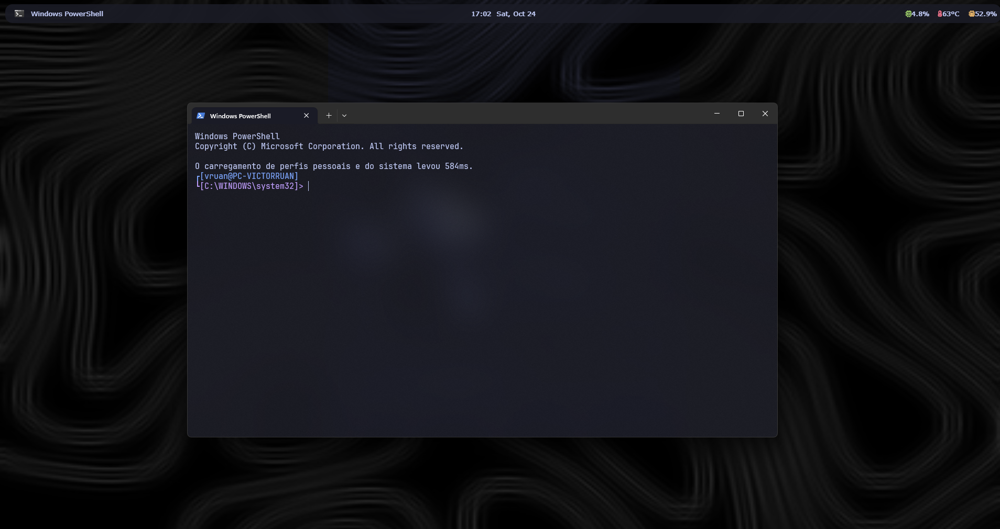

# Windows Rice · Tokyo Night

Visual de Windows 11 inspirado nos [dotfiles do eldskald](https://github.com/eldskald/dotfiles) (Hyprland no Arch), recriado com ferramentas do Windows: barra flutuante no topo, terminal translúcido e paleta Tokyo Night.





## O que tem aqui

| Peça | Ferramenta | Pasta |
|---|---|---|
| Barra flutuante | [YASB](https://github.com/amnweb/yasb) | `yasb/` |
| Prompt do terminal | [Oh My Posh](https://ohmyposh.dev) | `oh-my-posh/` |
| Terminal | Windows Terminal (esquema Tokyo Night) | `terminal/` |
| Perfil do PowerShell | `Microsoft.PowerShell_profile.ps1` | raiz |
| Temperatura da CPU | [LibreHardwareMonitor](https://github.com/LibreHardwareMonitor/LibreHardwareMonitor) | só o `sensor_id` no `config.yaml` |
| Papel de parede | Wallpaper Engine | não incluído |

## Paleta

| Uso | Cor |
|---|---|
| Fundo | `#1a1b26` |
| Texto | `#c0caf5` |
| Azul (destaque) | `#7aa2f7` |
| Roxo | `#bb9af7` |
| Verde | `#9ece6a` |
| Amarelo | `#e0af68` |
| Rosa | `#f7768e` |
| Ciano | `#7dcfff` |

## Como instalar

1. Instale os programas:

```powershell
winget install AmN.yasb
winget install JanDeDobbeleer.OhMyPosh
winget install Fastfetch-cli.Fastfetch
winget install LibreHardwareMonitor.LibreHardwareMonitor
winget install DEVCOM.JetBrainsMonoNerdFont
Set-ExecutionPolicy -ExecutionPolicy RemoteSigned -Scope CurrentUser
```

2. Copie os arquivos desta pasta para os lugares certos (rode dentro da pasta do repositório):

```powershell
New-Item -ItemType Directory -Force "$HOME\.config\yasb", "$HOME\.config\oh-my-posh" | Out-Null
Copy-Item yasb\* "$HOME\.config\yasb\" -Force
Copy-Item oh-my-posh\* "$HOME\.config\oh-my-posh\" -Force
New-Item -ItemType File -Force $PROFILE | Out-Null
Copy-Item Microsoft.PowerShell_profile.ps1 $PROFILE -Force
```

3. Windows Terminal: copie `terminal\settings.json` para
`%LOCALAPPDATA%\Packages\Microsoft.WindowsTerminal_8wekyb3d8bbwe\LocalState\settings.json`
(isso substitui as suas configurações atuais do terminal).

4. Temperatura: abra o LibreHardwareMonitor como administrador e ative `Options > Remote Web Server > Run`, `Run On Windows Startup` e `Start Minimized`. O `sensor_id` no `yasb/config.yaml` é específico de cada PC. Para achar o seu, abra `http://localhost:8085/data.json` e procure o sensor de temperatura da CPU.

5. Deixe a barra do Windows em ocultar automaticamente e inicie a barra:

```powershell
yasb
```

## Notas

- A barra usa o `windows_app_bar`, então as janelas respeitam o espaço dela.